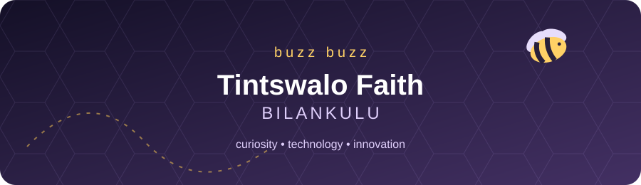

<div align="center">




<br/>

[](https://tintswalofaith.netlify.app/)
[](https://www.linkedin.com/in/tintswalobilankulu)
[](mailto:tintswalofaith99@gmail.com)


</div>

---

## 🍯 Behind the Buzz

Hey there! I'm Tintswalo Faith.

A curious mind from South Africa exploring technology, business, innovation and everything in between.

I'm currently pursuing my BSc Honours in Computing at UNISA, following my Bachelor's degree in Information Technology in Business Systems.

I enjoy understanding how things work, connecting ideas and exploring how technology can solve meaningful problems.

Sometimes that means writing code. Sometimes it's researching, designing systems, exploring business ideas or flying drones.

I'm still discovering where all these interests will take me, and that's what makes the journey exciting.

> Curious by nature. Tech by choice. Always evolving.

---

## 🧬 My Digital DNA

```yaml
identity: Tintswalo Faith Bilankulu
origin: South Africa
signature: "buzz buzz"

interests:
  - Computing & Information Systems
  - Business Analysis
  - Cybersecurity
  - Enterprise Architecture
  - Artificial Intelligence
  - Drones & Geospatial Technology
  - Entrepreneurship

personality:
  curiosity: unlimited
  creativity: always active
  learning: continuous
  comfort_zone: expanding

current_status: Becoming
```

---

## 🛠️ The Hive

A growing collection of technologies and skills I've explored throughout my journey.

<div align="center">

### Languages & Web


### Databases


### Development Tools


### Beyond Code


</div>

---

## 🚀 Made in the Hive

A few things I've built, explored and brought to life.

| Project | The idea |
|---|---|
| 🌌 [My Digital Universe](https://tintswalofaith.netlify.app/) | My personal portfolio and a little corner of the internet that belongs to me. |
| 💰 [CoinBliss](https://github.com/Tintswalo-Bilankulu/CoinblissPrototype) | A financial technology prototype exploring innovative digital solutions. |
| 🐾 PAWS | A Pets Adoption Workflow System developed during my work-integrated learning experience. |
| ☕ [Java POE](https://github.com/Tintswalo-Bilankulu/Java_POE) | Exploring object-oriented programming through academic development. |
| 🐝 BEELAS | An evolving entrepreneurial vision inspired by curiosity, technology and innovation. |

<div align="center">

*More ideas are quietly buzzing in the background...*

</div>

---

## 🔬 What's Buzzing?

Currently exploring the world of information security through my Honours research.

### Research title

**A systematic review of Information Security Policy Compliance: Towards a conceptual model for research and practice**

My research interests include:

- Information Security Policy Compliance
- Human Behaviour in Cybersecurity
- Information Security Governance
- Information Systems Research

I'm particularly interested in understanding the relationship between people, organisations and technology.

---

## 🚁 Beyond the Hive

Not all technology stays on the ground.

I completed the Inhlanyelo Hub Drone Industry Business Start-up Programme, exploring the commercial possibilities of unmanned aircraft systems.

### Qualifications


I'm interested in how drones, AI and geospatial technologies can contribute to infrastructure inspection, disaster management and innovative business solutions.

---

## 🏆 Milestones Unlocked

- 🎓 Bachelor of IT in Business Systems
- 📖 BSc Honours in Computing — in progress
- 🏅 Golden Key International Honour Society
- 🤝 Class Representative for two years
- 📋 Work-integrated learning project leadership
- 🚁 Professional drone industry training

Every milestone is another chapter, not the final destination.

---

## 📊 A Little GitHub Magic

<div align="center">


<br/>


</div>

---

## 🐝 The Flight Path

<div align="center">

<picture>
  <source media="(prefers-color-scheme: dark)" srcset="https://raw.githubusercontent.com/Tintswalo-Bilankulu/Tintswalo-Bilankulu/output/github-contribution-grid-snake-dark.svg"/>
  <source media="(prefers-color-scheme: light)" srcset="https://raw.githubusercontent.com/Tintswalo-Bilankulu/Tintswalo-Bilankulu/output/github-contribution-grid-snake.svg"/>
  
</picture>

*Small steps. Big ideas. A little buzz every day.*

</div>

---

## 🌻 The Human Behind the Screen

Outside of technology, you'll probably find me:

- Listening to music
- Staying active
- Spending time with my puppy
- Meeting new people
- Exploring new business ideas
- Discovering something unexpectedly interesting

Because life is about more than what we build on a screen.

---

## 💌 Catch the Buzz

<div align="center">

[](https://tintswalofaith.netlify.app/)
[](https://www.linkedin.com/in/tintswalobilankulu)
[](https://instagram.com/faith_bilas)

---

### The journey is still being written.

Made with curiosity, creativity and a little honey.

**buzz buzz 🐝**


</div>


